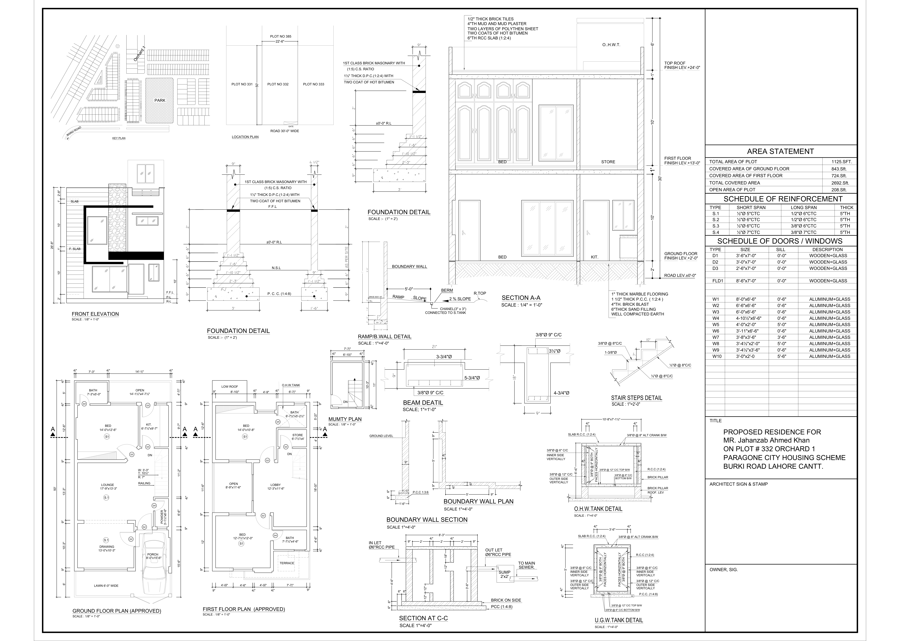
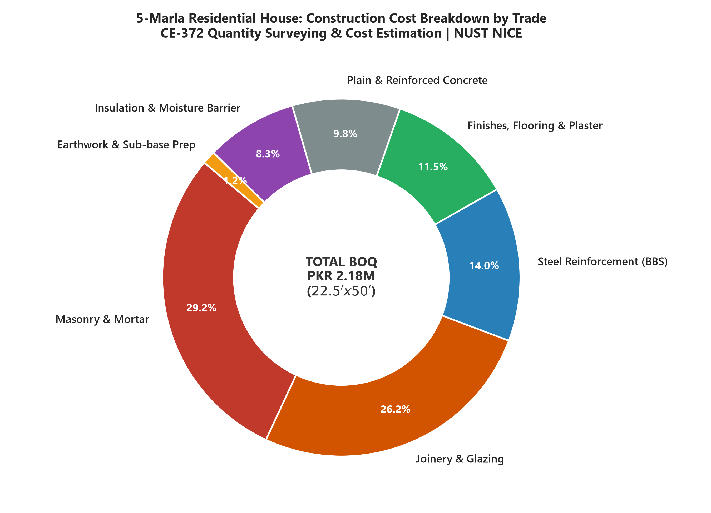
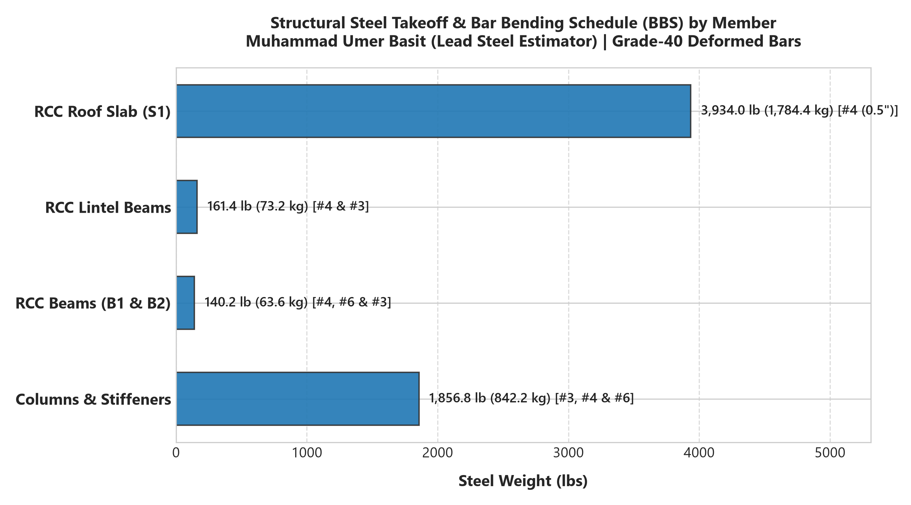
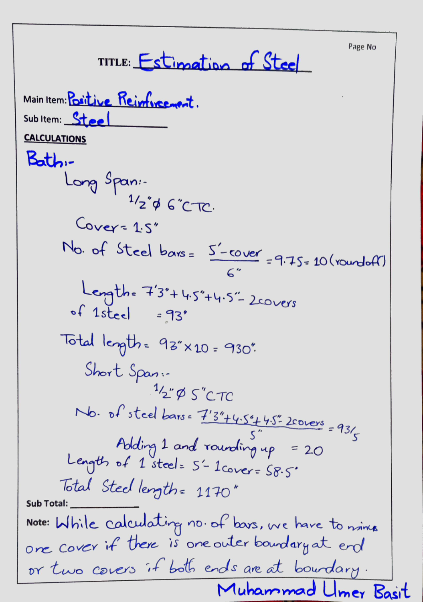
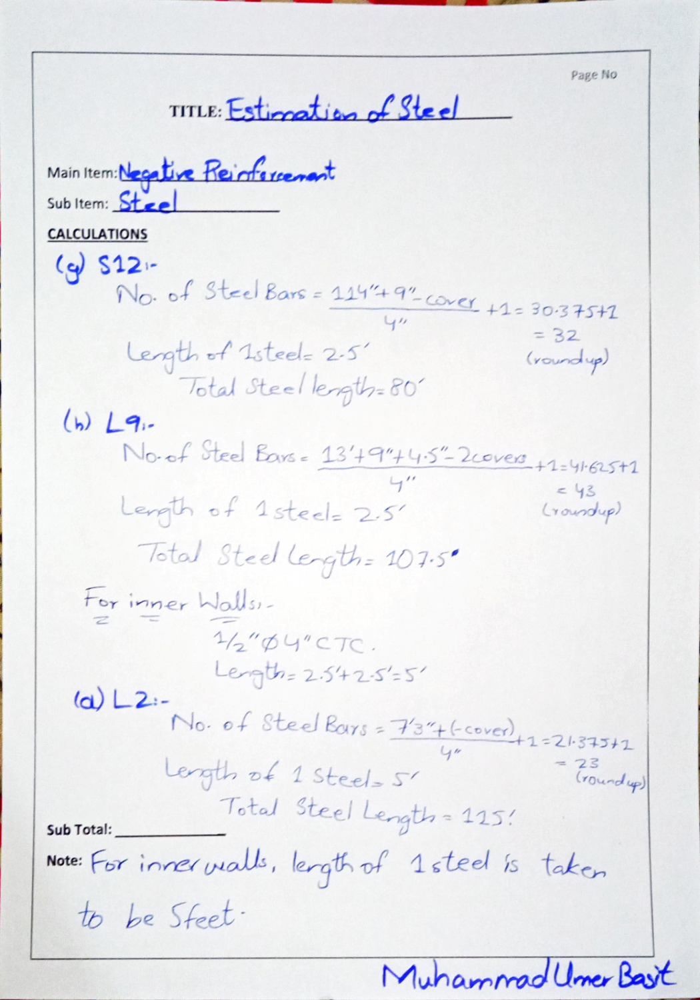
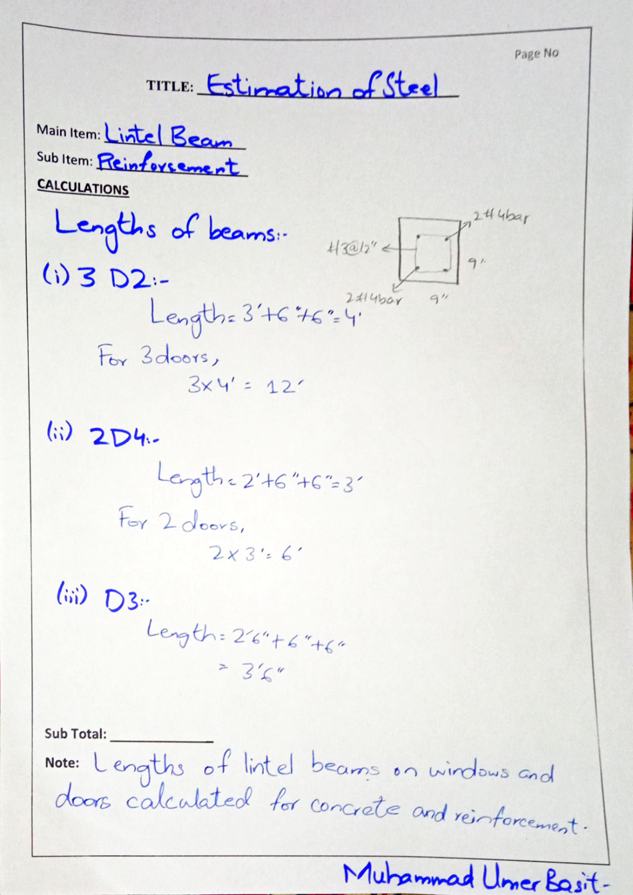

# Quantity Surveying, Bar Bending Schedule (BBS) & Cost Estimation: 5-Marla Residential House

[-blue.svg)](#project-overview--specifications)
[](#project-overview--specifications)
[](#author--academic-attribution)
[](#bill-of-quantities-boq-breakdown)
[-informational.svg)](#structural-steel-takeoff--bar-bending-schedule-bbs)
[](#schedule-of-rates--rate-analysis)
[](LICENSE)

An exhaustive, practical civil engineering quantity surveying, material takeoff, bar bending scheduling, and construction cost estimation portfolio for a **5-Marla ($22.5\text{ ft} \times 50\text{ ft}$) single-storey residential house** situated in **Paragon City Housing Scheme, Burki Road, Lahore Cantt, Pakistan**.

The project encompasses a complete **Bill of Quantities (BOQ)**, municipal by-law verification, **19-page handwritten Bar Bending Schedule (BBS) for all structural steel reinforcement**, and rate analysis based on the **Punjab Composite Schedule of Rates (CSR)** and **Military Engineering Services (MES) Schedule of Rates**.

**Author:** **Muhammad Umer Basit** (Civil Engineering Student)  
**Role in Project:** **Lead Estimator for Structural Steel Works & Bar Bending Schedule (BBS)**  
**Collaborators:** Muhammad Abdullah, Muhammad Ali, Muhammad Sameer, Muhammad Anique  
**Institution:** NUST Institute of Civil Engineering (NICE), National University of Sciences and Technology (NUST), Islamabad, Pakistan  
**Course:** CE-372: Quantity Surveying & Cost Estimation (QS&CE, Semester 6)

---

## 📌 Architectural & Structural Blueprint

The estimation is performed on the architectural working drawings, elevations, sections, and structural details for a $22.5\text{ ft} \times 50\text{ ft}$ residential dwelling:



> **High-Resolution Vector Layout:** Download the full high-resolution drawing in [`architectural-and-structural-drawings/5-Marla-Residential-House-Submission-Plan.pdf`](architectural-and-structural-drawings/5-Marla-Residential-House-Submission-Plan.pdf).

---

## 📐 Project Overview & Specifications

| Parameter | Project Dimension / Engineering Detail |
| :--- | :--- |
| **Site Location** | Paragon City Housing Scheme, Burki Road, Lahore Cantt, Punjab, Pakistan |
| **Plot Dimensions** | **$22.5\text{ ft} \times 50\text{ ft}$** ($1,125\text{ sq ft}$ / $5\text{ Marla}$) |
| **Ground Floor Covered Area** | **$843\text{ sq ft}$** (74.9% Ground Coverage) |
| **Open Courtyard & Lawn Area** | **$282\text{ sq ft}$** (Front Lawn: $6'\times 15'6"$, Rear Open Space: $8'9"\times 11'6"$) |
| **Architectural Spaces** | Master Bedroom ($14'\times 12'6"$) with en-suite Bath ($7'3"\times 5'$), Living/TV Lounge ($17'9"\times 13'3"$), Drawing Room ($13'\times 10'3"$), Kitchen ($6'7.5"\times 9'7"$), Powder Room, Front Car Porch ($8'\times 15'6"$), and Service Passage |
| **Structural Typology** | Confined load-bearing brick masonry with Reinforced Cement Concrete (RCC) slab, plinth beams, tie beams, and lintels |
| **Masonry Specification** | First-class burnt clay bricks laid in 1:4 cement-sand mortar |
| **Reinforcement Steel** | ASTM A615 **Grade 40 Deformed Steel Bars** ($F_y = 40,000\text{ psi}$) |
| **Schedule of Rates** | Punjab Composite Schedule of Rates (CSR) & Military Engineering Services (MES) |
| **Total Base Project Cost** | **PKR 2,184,386.16** (~$2.18\text{ Million PKR}$) |

---

## 📊 Bill of Quantities (BOQ) Breakdown

The estimation was modeled in Microsoft Excel ([`boq-and-cost-estimates/Bill-of-Quantities-Complete.xlsx`](boq-and-cost-estimates/Bill-of-Quantities-Complete.xlsx)) across 23 standardized construction line items:



### Summary of Construction Cost by Major Trades:

| Item # | Major Construction Trade / Work Package | Detailed Description & Engineering Scope | Total Quantity & Unit | Rate (PKR) | Amount (PKR) | % of Total |
| :---: | :--- | :--- | :---: | :---: | :---: | :---: |
| **01** | **Earthwork & Excavation** | Open cutting excavation up to $5'$ depth for foundations and trenches | $935.52\text{ cft}$ | 7,623.55 / 1000 cft | **7,128.02** | 0.33% |
| **02** | **Plain & Reinforced Concrete** | Cement concrete 1:4:8 in foundation beds & 1:2:4 in footings/plinth | $915.34\text{ cft}$ | 22,977.75 / 100 cft | **210,324.54** | 9.63% |
| **03** | **Substructure Brickwork** | Pacca brickwork in foundation & plinth up to DPC level (1:4 mortar) | $1,065.23\text{ cft}$ | 27,027.50 / 100 cft | **287,904.50** | 13.18% |
| **04** | **Superstructure Brickwork** | Pacca brickwork in ground floor walls up to slab level (1:4 mortar) | $1,402.53\text{ cft}$ | 23,707.60 / 100 cft | **332,506.68** | 15.22% |
| **05** | **Parapet & Roof Brickwork** | Parapet wall masonry around roof perimeter | $36.63\text{ cft}$ | 24,668.05 / 100 cft | **9,035.24** | 0.41% |
| **06** | **Joinery (Teak Woodwork)** | 1st class teak doors, chowkats, brass fittings, holdfasts & locks | $119.00\text{ sft}$ | 3,774.00 / sft | **449,106.00** | 20.56% |
| **07** | **Glazed Bronze Aluminum Windows** | 1.6mm deluxe bronze sections with 5mm tinted glass and rubber gaskets | $115.83\text{ sft}$ | 477.00 / sft | **55,250.91** | 2.53% |
| **08** | **Main Entrance Steel Gate** | Grated steel gate with angle frame ($2"\times 2"\times 3/8"$) & $3/4"$ square bars | $48.00\text{ sft}$ | 1,251.95 / sft | **60,093.60** | 2.75% |
| **09** | **Structural Steel Reinforcement** | Mild/deformed Grade-40 steel cutting, bending, binding & fixing (BBS) | $4,165.61\text{ lb}$ | 8,090.45 / cwt | **300,907.67** | 13.78% |
| **10** | **Cement Plastering (1:4)** | 1/2" thick cement-sand plaster (1:4) on internal & external wall surfaces | $4,356.69\text{ sft}$ | 2,153.80 / 100 sft | **93,834.39** | 4.30% |
| **11** | **Weather Shield Exterior Paint** | 2 coats weather shield exterior paint over primer | $1,520.21\text{ sft}$ | — | **44,363.53** | 2.03% |
| **12** | **Interior Emulsion Paint** | 2 coats interior vinyl emulsion paint over prepared surface | $3,249.21\text{ sft}$ | — | **30,112.41** | 1.38% |
| **13** | **Mosaic Marble Flooring** | 1" thick mosaic marble chips tiles with white cement & pigment | $903.07\text{ sft}$ | 9,226.45 / 100 sft | **83,321.49** | 3.81% |
| **14** | **Floor Tiles & Skirting** | Glazed ceramic floor tiles & 4" skirting in 1:2 cement mortar | $361.76\text{ sft}$ | — | **23,731.90** | 1.09% |
| **15** | **Damp Proof Course (DPC)** | 1.5" thick cement concrete 1:2:4 with hot bitumen seal coat | $11.83\text{ sft}$ | 5,112.35 / sft | **60,462.06** | 2.77% |
| **16** | **Roof Insulation & Waterproofing** | 2 coats hot bitumen ($34\text{ lb/100 sft}$) + 2 layers Extruded Polystyrene XPS | $903.06\text{ sft}$ | — | **117,429.79** | 5.38% |
| **17** | **Sub-base Preparation & Filling** | 6" sand filling under floor ($490.5\text{ cft}$) & compacted earth ($2,108.8\text{ cft}$) | — | — | **17,732.10** | 0.81% |
| **18** | **Backfilling Around Trenches** | Surplus excavated material backfilled and compacted within 50ft lead | $149.71\text{ cft}$ | 7,623.55 / 1000 cft | **1,141.34** | 0.05% |
| **—** | **TOTAL BASE ESTIMATE** | **Comprehensive Construction Cost for 5-Marla House** | — | — | **PKR 2,184,386.16** | **100.00%** |

---

## 🛠️ Structural Steel Takeoff & Bar Bending Schedule (BBS)

### Muhammad Umer Basit's Specialized Project Deliverable
As the **Lead Structural Steel Estimator**, Muhammad Umer Basit authored the **19-page handwritten calculation book** [`steel-takeoff-and-bbs/Structural-Steel-Takeoff-and-Bar-Bending-Schedule-Umer-Basit.pdf`](steel-takeoff-and-bbs/Structural-Steel-Takeoff-and-Bar-Bending-Schedule-Umer-Basit.pdf) determining the exact reinforcement schedules across all structural members:



### Bar Bending Schedule (BBS) Technical Breakdown:

| Structural Component | Bar Designation | Rebar Diameter | Total Length (ft) | Unit Weight (lb/ft) | Total Weight (lbs) | Total Weight (kg) |
| :--- | :---: | :---: | :---: | :---: | :---: | :---: |
| **RCC Roof Slab ($S_1$) - Positive Reinforcement** | #4 | $0.50"$ ($12\text{ mm}$) | $3,724.25\text{ ft}$ | $0.668\text{ lb/ft}$ | $2,487.80\text{ lb}$ | $1,128.45\text{ kg}$ |
| **RCC Roof Slab ($S_1$) - Negative Distribution Bars** | #4 | $0.50"$ ($12\text{ mm}$) | $2,165.00\text{ ft}$ | $0.668\text{ lb/ft}$ | $1,446.22\text{ lb}$ | $655.99\text{ kg}$ |
| **Main Beams ($B_1, B_2$) - Longitudinal Top/Bottom** | #6 | $0.75"$ ($19\text{ mm}$) | $30'8"\text{ ft}$ | $1.502\text{ lb/ft}$ | $46.06\text{ lb}$ | $20.89\text{ kg}$ |
| **Main Beams ($B_1, B_2$) - Longitudinal Mid Bars** | #4 | $0.50"$ ($12\text{ mm}$) | $23'0"\text{ ft}$ | $0.668\text{ lb/ft}$ | $15.36\text{ lb}$ | $6.97\text{ kg}$ |
| **Main Beams ($B_1, B_2$) - Shear Stirrups (6" c/c)** | #3 | $0.375"$ ($10\text{ mm}$) | $23'4"\text{ ft}$ | $0.376\text{ lb/ft}$ | $8.77\text{ lb}$ | $3.98\text{ kg}$ |
| **Lintel Beams - Main Longitudinal Bars** | #4 | $0.50"$ ($12\text{ mm}$) | $182.50\text{ ft}$ | $0.668\text{ lb/ft}$ | $121.91\text{ lb}$ | $55.30\text{ kg}$ |
| **Lintel Beams - Closed Stirrups** | #3 | $0.375"$ ($10\text{ mm}$) | $105.00\text{ ft}$ | $0.376\text{ lb/ft}$ | $39.48\text{ lb}$ | $17.91\text{ kg}$ |
| **Columns ($C_1, C_2$) & Strip Footings** | #3, #4, #6 | $10, 12, 19\text{ mm}$ | Multi-bay ties | Combined | $1,856.84\text{ lb}$ | $842.25\text{ kg}$ |
| **TOTAL STRUCTURAL STEEL FABRICATION** | — | — | **$9,161.42\text{ ft}$** | — | **$4,165.61\text{ lb}$** | **$1,889.49\text{ kg}$ (1.89 Tons)** |

### Original Steel Calculation Sheets:

| Roof Slab Reinforcement Schedule | Beam & Lintel Bar Details | Column Ties & Starter Dowels |
| :---: | :---: | :---: |
|  |  |  |
| *Room-by-room slab bar lengths* | *Stirrup spacing & hook development* | *Column vertical bars and ties* |

---

## 📜 Municipal Building By-Laws & Setbacks Compliance

The design and estimation follow the local housing scheme by-laws documented in [`boq-and-cost-estimates/Building-By-Laws-and-Setbacks.docx`](boq-and-cost-estimates/Building-By-Laws-and-Setbacks.docx):

- **Plot Size Category:** 5 Marla ($1,125\text{ sq ft}$)
- **Mandatory Setbacks:**
  - Front Setback (Lawn): **$6\text{ ft}$ clear setback**
  - Rear Setback (Open Courtyard): **$5\text{ ft}$ minimum**
  - Side Passages: Not mandatory for 5-marla residential row houses
- **Ground Floor Footprint:** $843\text{ sq ft}$ ($74.9\%$ plot coverage $\le 75\%$ maximum allowable)
- **Plinth Level:** $+3\text{ ft}$ above crown of the road level
- **Floor-to-Ceiling Clear Height:** $10\text{ ft}$ ($3.05\text{ m}$)
- **Boundary Wall Height:** $6\text{ ft}$ maximum above plinth

---

## 📂 Repository File Structure

```
Quantity-Surveying-Cost-Estimation-5Marla-House/
├── README.md                                             # Comprehensive technical report & documentation
├── LICENSE                                               # MIT License
├── .gitignore                                            # Office, Python cache and temp exclusions
│
├── boq-and-cost-estimates/                               # Formal cost estimation deliverables
│   ├── Bill-of-Quantities-Complete.xlsx                  # Fully linked 23-item Excel BOQ workbook
│   ├── Bill-of-Quantities-Official-Report.pdf            # 10-page formal item-by-item BOQ document
│   ├── Bill-of-Quantities-Specification-Document.docx    # Word specification and measurement document
│   └── Building-By-Laws-and-Setbacks.docx                # Municipal setback and zoning regulations
│
├── steel-takeoff-and-bbs/                                # Structural steel calculations
│   └── Structural-Steel-Takeoff-and-Bar-Bending-Schedule-Umer-Basit.pdf  # 19-page handwritten calculation book
│
├── architectural-and-structural-drawings/                 # Architectural floor plans & elevations
│   ├── 5-Marla-Residential-House-Submission-Plan.pdf     # Ground floor, front elevation, section A-A
│   ├── Building-Drawing-Submission.pdf                   # Secondary architectural submission plan
│   ├── 5-Marla-Site-Layout-Plumbing-Drainage.pdf         # Plumbing, manholes & drainage layout
│   └── 10-Marla-Submission-Model.pdf                     # Comparative 10-marla reference model
│
├── presentations-and-reports/                            # Course defense presentations & reports
│   ├── Quantity-Surveying-5-Marla-House-Final-Presentation.pptx  # 50-slide detailed defense presentation
│   ├── Group-3-QS-Cost-Estimation-Defense.pptx           # 37-slide group defense presentation
│   ├── Cost-Project-Takeoff-Report.pdf                   # Comprehensive takeoff calculation report
│   ├── Cost-Project-Plastering-Analysis.pdf              # Dedicated plastering area & mortar analysis
│   └── Course-Outline-CE-372.pdf                         # NUST OBE course outline & learning outcomes
│
├── lectures-and-schedule-of-rates/                       # Professional rates & academic curriculum
│   ├── MES-Schedule-of-Rates.pdf                         # Military Engineering Services Schedule of Rates
│   ├── Description-and-Units-of-Measurement.pdf          # Standard measurement units reference
│   ├── Term-Project-Guidelines.pdf                       # Project requirements & milestone rubric
│   └── CCEC-Lec01-Introduction.pdf to CCEC-Lec19-HVAC.pdf # Full 14-lecture academic slide series
│
├── scripts/                                              # Computational analysis scripts
│   └── boq_cost_and_steel_analysis.py                    # Python auditing & data visualization script
│
└── media/                                                # Documentation figures & charts
    ├── hero-5-marla-architectural-plan.png               # High-res architectural submission blueprint
    ├── boq-cost-breakdown-trade.png                      # Donut chart of budget distribution
    ├── steel-reinforcement-distribution-bbs.png          # Bar chart of steel weight by member
    ├── steel-takeoff-sample-slab.png                     # Slab bar bending schedule scan
    ├── steel-takeoff-sample-beam-lintel.png              # Beam/lintel reinforcement scan
    └── steel-takeoff-sample-columns-footings.png         # Column & footing takeoff scan
```

---

## 💻 Running the Computational Audit Script

To audit the Bill of Quantities, verify trade percentages, and regenerate publication charts:

```bash
# Clone the repository
git clone https://github.com/MuhammadUmerBasit/Quantity-Surveying-Cost-Estimation-5Marla-House.git
cd Quantity-Surveying-Cost-Estimation-5Marla-House

# Install required dependencies
pip install pandas numpy matplotlib openpyxl

# Execute the analysis script
python scripts/boq_cost_and_steel_analysis.py
```

---

## 👤 Author & Academic Attribution

- **Student / Author:** [Muhammad Umer Basit](https://github.com/MuhammadUmerBasit) (Civil Engineering Student)  
  *Lead Estimator: Structural Steel Takeoff & Bar Bending Schedule (BBS)*
- **Collaborators:** Muhammad Abdullah, Muhammad Ali, Muhammad Sameer, Muhammad Anique  
- **Department:** NUST Institute of Civil Engineering (NICE)  
- **Institution:** National University of Sciences and Technology (NUST), Islamabad, Pakistan  
- **Course:** CE-372: Quantity Surveying and Cost Estimation (Semester 6)

---

## 📄 License

This repository is distributed under the open-source [MIT License](LICENSE).
